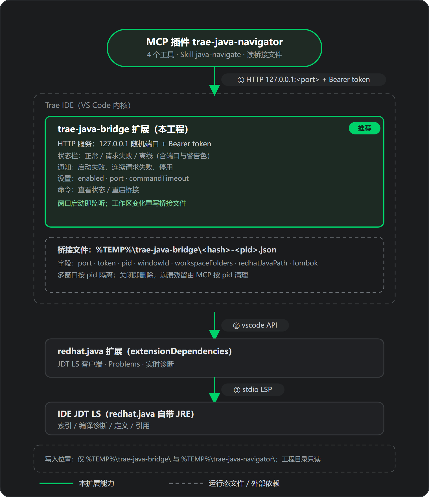
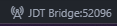

# Trae Java Bridge

<p align="center">
  <a href="https://github.com/lianghujun/trae-java-bridge/blob/main/package.json"></a>
  <a href="https://github.com/lianghujun/trae-java-bridge"></a>
  <a href="https://github.com/lianghujun/trae-java-bridge/blob/main/package.json"></a>
  <a href="https://github.com/lianghujun/trae-java-bridge/commits/main"></a>
  <a href="https://github.com/lianghujun/trae-java-bridge/stargazers"></a>
  <a href="https://github.com/lianghujun/trae-java-bridge/blob/main/LICENSE"></a>
</p>

<p align="center">
  English | <a href="./README.md">简体中文</a>
</p>

<p align="center">
  <b>Securely expose the IDE's Java language services to a local MCP client</b><br/>
  Symbols · definitions · references · hover · live compiler diagnostics
</p>

<p align="center">
  Companion MCP plugin: <a href="https://github.com/lianghujun/trae-java-navigator">trae-java-navigator</a>
</p>

<p align="center">
  127.0.0.1 only · random port + Bearer token · observable in the status bar · never writes to your project
</p>

## Quick Start

> **AGENT NOTE**: To install this extension for Trae / VS Code, run `npm run package:vsix && node install.mjs --vsix dist/trae-java-bridge.vsix` in the repository root; if redhat.java is not installed, ask the user to install it first. When done, ask the user to fully restart the IDE.

```powershell
npm run package:vsix
node install.mjs --vsix dist/trae-java-bridge.vsix
```

If you use the companion MCP plugin, running `node install.mjs` in that plugin's directory installs this bundled extension automatically — no separate steps needed.

**Fully restart Trae** for the extension to take effect.

## Platform Compatibility

| Environment | Supported | Notes |
|---|---|---|
| Trae CN / Trae | ✅ | Designed to work with the MCP plugin |
| VS Code / Cursor etc. | ✅ | Usable standalone; any MCP client can call it |

## Features

- Symbol search: class / method / field locations (1-based line and column)
- Definition jumps, reference search, hover and file outlines
- Live compiler errors and warnings, consistent with the Problems panel
- Listens on `127.0.0.1` only, random port + Bearer token, never exposed to the network

## Dependencies

- **redhat.java** (required, declared in `extensionDependencies`): provides the JDT LS and diagnostics; this extension will not activate without it
- **Lombok Annotations Support for VS Code** (optional): recommended for Lombok projects; this extension auto-detects its agent jar but does not require it
- Companion MCP plugin `trae-java-navigator`: reads the bridge file written by this extension

This extension does not declare `contributes.languages`: it provides no grammar, language configuration or language service, and only calls the IDE's generic command APIs. Declaring the `java` language again would conflict with redhat.java's language configuration.

## Overall Relationship



- This extension only forwards requests and shows status; it provides no language capability, hence no `contributes.languages`
- It writes only to the system temp directory, never to the project; bridge files are deleted when the window closes
- The MCP-side Skill (`java-navigate`) defines triggering and usage rules, complementing this extension

## How It Works

At window startup (`onStartupFinished`) the extension listens on a random local port and writes a rendezvous file into the system temp directory:

```text
%TEMP%\trae-java-bridge\<workspace-hash>-<pid>.json
```

The file contains the port, token, window identity, workspace list, and redhat.java / Lombok probe results. The MCP side matches by workspace and verifies the process is alive, so multiple windows never overwrite each other. The file is deleted when the window closes, and leftovers from crashes are cleaned up by the MCP server.

Endpoints: `/health`, `/diagnostics`, `/symbols`, `/definition`, `/references`, `/documentSymbols` (supports `name` / `kind` / `limit` filters), `/hover`.

## Installation Details

- **VSIX install (recommended)**: the IDE registers full extension metadata, so the details page shows the icon and README
- **Directory install**: for development only; the details page shows a placeholder icon and no README
- If the IDE CLI cannot be found, set `TRAE_CLI`, or use "Install from VSIX" in the extension panel
- Uninstall: `node uninstall.mjs --extensions-dir <dir>`, or uninstall from the extension panel

## Usage

1. Install and enable this extension (requires redhat.java)
2. Open a Java project containing `pom.xml` or `build.gradle`
3. Call `java_status` from the MCP side; `source` = `ide-bridge` means the IDE's language service is being reused

## Notifications

Failures are reported through the IDE notification panel (bottom-right notification center) instead of throwing exceptions; each issue is shown only once per window:

| Event | Level | Buttons |
|---|---|---|
| Bridge failed to start (port in use, etc.) | Error | Show Status / Restart Bridge |
| 3 consecutive request failures (JDT LS not ready, etc.) | Warning | Show Status / Restart Bridge |
| `enabled` turned off in settings | Information | Show Status |

Single request failures do not pop up a notification; the status bar turns to a warning color instead, and the state resets automatically after recovery so notifications can fire again.

Status bar indicator example (shows the port while running normally):

<p align="center">
  
</p>

## Status Bar

Bottom-right status bar of the window:

| State | Icon and text |
|---|---|
| Normal | `$(radio-tower) JDT Bridge:<port>` |
| Recent request failed | `$(warning) JDT Bridge:<port>` (warning background) |
| Bridge not running / extension error | `$(debug-disconnect) JDT Bridge:offline` (warning background) |
| `enabled` turned off in settings | Hidden |

- Hover to see the workspace, redhat.java activation state, Lombok, request count and the last error
- Click to open the status panel; the command palette also provides `Trae Java Bridge: Restart Bridge`

## Configuration

Extension settings (Settings → Extensions → Trae Java Bridge):

| Setting | Default | Description |
|---|---|---|
| `traeJavaBridge.enabled` | `true` | Enable/disable the bridge; when off, no port is opened and no bridge file is written |
| `traeJavaBridge.port` | `0` | `0` means a random port; a fixed port helps with firewalls/port forwarding but loses automatic multi-window isolation |
| `traeJavaBridge.commandTimeout` | `15000` | Timeout per IDE command (ms); on timeout the MCP side falls back to the standalone JDT LS |

Environment variables (advanced):

| Variable | Purpose | Default |
|---|---|---|
| `TRAE_JAVA_BRIDGE_DIR` | Bridge file directory | `trae-java-bridge` inside the system temp directory |
| `TRAE_JAVA_BRIDGE_TIMEOUT` | Command timeout (ms; used when the setting is unset) | `15000` |
| `LOMBOK_JAR` | Explicit lombok agent jar | Auto-detected |

## Notes

IDE diagnostics are for fast localization, not a substitute for the build gate. JDT LS classpaths and annotation processing are not fully equivalent to Maven; always finish with `mvnw -DskipTests test-compile`.

With remote development (Remote-SSH / containers), the extension runs on the remote side and writes bridge files to the remote system temp directory, which the local MCP server cannot read by default. Point `TRAE_JAVA_BRIDGE_DIR` at a shared path, or run the MCP server and the IDE on the same side.

## Troubleshooting

| Symptom | Action |
|---|---|
| Status bar shows `JDT Bridge:offline` | Check `traeJavaBridge.enabled`; run `Trae Java Bridge: Restart Bridge` from the command palette |
| Status bar is in warning color | The last request failed; hover for the error and confirm redhat.java is active |
| Port-in-use notification | Set `traeJavaBridge.port` back to `0` (random port) |
| MCP reports `standalone-jdtls` | The extension is inactive or the bridge directories differ; make sure both sides use the same `TRAE_JAVA_BRIDGE_DIR` |
| Symbols not found | Confirm a Java project is open and wait for redhat.java to finish indexing |

## Uninstall

Prefer uninstalling from the extension panel (the IDE cleans up its registration).

Only for directory-copy installs used during development do you need to run `node uninstall.mjs` in the extension source directory.

Uninstalling removes the extension directory, the `extensions.json` entry and the bridge files written by this project.

## License

[MIT](LICENSE) © 2026 lianghujun

Our own code is released under MIT; runtime dependencies such as redhat.java (EPL-2.0) and Lombok (MIT) follow their own licenses and are not redistributed in this repository.

## Disclaimer

This project is a third-party open-source extension developed for TRAE. TRAE is a registered trademark of its respective owner. This project is not affiliated with, sponsored by, certified by or partnered with TRAE officially. All trademark rights belong to their respective owners.

## Support the Author

If this project helps you, you are welcome to scan the QR code and buy the author a coffee. Your support keeps the project maintained and updated.

<p align="center">
  
</p>

> Note: this is a voluntary donation, not a commercial transaction; no invoices or commercial support are provided.