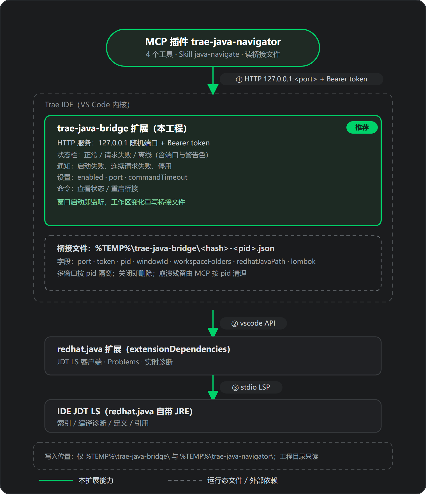

# Trae Java Bridge

<p align="center">
  <a href="https://github.com/lianghujun/trae-java-bridge/blob/main/package.json"></a>
  <a href="https://github.com/lianghujun/trae-java-bridge"></a>
  <a href="https://github.com/lianghujun/trae-java-bridge/blob/main/package.json"></a>
  <a href="https://github.com/lianghujun/trae-java-bridge/commits/main"></a>
  <a href="https://github.com/lianghujun/trae-java-bridge/stargazers"></a>
  <a href="https://github.com/lianghujun/trae-java-bridge/blob/main/LICENSE"></a>
</p>

<p align="center">
  <b>把 IDE 的 Java 语言服务安全地暴露给本机 MCP</b><br/>
  符号 · 定义 · 引用 · hover · 实时编译诊断
</p>

<p align="center">
  配套 MCP 插件：<a href="https://github.com/lianghujun/trae-java-navigator">trae-java-navigator</a>
</p>

<p align="center">
  仅监听 127.0.0.1 · 随机端口 + Bearer token · 状态栏可观测 · 不写工程目录
</p>

## 快速开始

> **AGENT 提示**：请为 Trae / VS Code 安装当前扩展：在仓库根目录直接执行 `npm run package:vsix && node install.mjs --vsix dist/trae-java-bridge.vsix`；若检测到未安装 redhat.java，先提示用户安装。成功后提示用户完全重启 IDE。

```powershell
npm run package:vsix
node install.mjs --vsix dist/trae-java-bridge.vsix
```

若使用配套 MCP 插件，在插件目录执行 `node install.mjs` 会自动安装随包携带的本扩展，无需单独操作。

**完全重启 Trae** 后生效。

## 平台兼容

| 环境 | 支持 | 说明 |
|---|---|---|
| Trae CN / Trae | ✅ | 与 MCP 插件组合使用 |
| VS Code / Cursor 等 | ✅ | 可独立使用，供任意 MCP 客户端调用 |

## 功能

- 符号搜索：类 / 方法 / 字段位置（1-based 行列）
- 定义跳转、引用查找、hover、文件结构
- 实时编译错误/警告：与 Problems 面板一致
- 仅监听 `127.0.0.1`，随机端口 + Bearer token，不对外暴露

## 依赖

- **redhat.java**（必需，已在 `extensionDependencies` 声明）：提供 JDT LS 与诊断；未安装或未启用时本扩展不会激活
- **Lombok Annotations Support for VS Code**（可选）：项目使用 Lombok 时建议安装；本扩展会自动探测其 agent jar，但不会强制依赖
- 配套 MCP 插件 `trae-java-navigator`：由它读取本扩展写出的桥接文件

本扩展不声明 `contributes.languages`：它不提供语法、语言配置或语言服务，只调用 IDE 的通用命令接口。重复声明 `java` 语言会和 redhat.java 的语言配置冲突。

## 整体关系



- 本扩展只做“转发与状态展示”，不提供语言能力，因此不声明 `contributes.languages`
- 只写系统临时目录，不写工程目录；窗口关闭即删除桥接文件
- MCP 侧的技能（`java-navigate`）负责触发与使用规范，与本扩展互补

## 工作方式

扩展在窗口启动时（`onStartupFinished`）监听本机随机端口，并在系统临时目录写入会合文件：

```text
%TEMP%\trae-java-bridge\<workspace-hash>-<pid>.json
```

文件包含端口、token、窗口标识、工作区列表、redhat.java 与 Lombok 探测结果。MCP 侧按工作区匹配并校验进程存活，多个窗口互不覆盖；窗口关闭时文件自动删除，异常退出留下的文件会被 MCP 清理。

提供接口：`/health`、`/diagnostics`、`/symbols`、`/definition`、`/references`、`/documentSymbols`（支持 `name`/`kind`/`limit` 过滤）、`/hover`。

## 安装细节

- **VSIX 安装（推荐）**：IDE 会完整登记扩展元数据，详情页能显示图标与自述文件
- **目录安装**：仅用于开发调试，详情页会显示默认占位图标、无自述文件
- 找不到 IDE CLI 时，可用 `TRAE_CLI` 指定，或在 IDE 扩展面板中选择“从 VSIX 安装”
- 卸载：`node uninstall.mjs --extensions-dir <dir>`，或直接在 IDE 扩展面板卸载

## 使用

1. 安装并启用本扩展（依赖 redhat.java）
2. 打开包含 `pom.xml` 或 `build.gradle` 的 Java 工程
3. MCP 侧调用 `java_status`，`source` 为 `ide-bridge` 即表示已复用 IDE 的语言服务

## 通知

异常通过 IDE 通知面板（右下角通知中心）提示，不向用户抛异常，同一问题每个窗口只提示一次：

| 事件 | 级别 | 按钮 |
|---|---|---|
| 桥接启动失败（端口占用等） | 错误 | 查看状态 / 重启桥接 |
| 连续 3 次请求失败（JDT LS 未就绪等） | 警告 | 查看状态 / 重启桥接 |
| 设置中关闭 `enabled` | 信息 | 查看状态 |

单次请求失败不弹窗，只把状态栏切为警告色；恢复正常后自动清除提示状态，可再次触发通知。

状态栏指示示例（正常运行时显示端口）：

<p align="center">
  
</p>

## 状态栏

窗口右下角状态栏：

| 状态 | 图标与文字 |
|---|---|
| 正常 | `$(radio-tower) JDT Bridge:<port>` |
| 最近请求失败 | `$(warning) JDT Bridge:<port>`（警告底色） |
| 桥接未运行/扩展异常 | `$(debug-disconnect) JDT Bridge:离线`（警告底色） |
| 设置中关闭 `enabled` | 隐藏 |

- 悬停可看工作区、redhat.java 激活状态、Lombok、请求数与最近错误
- 点击后打开状态面板；命令面板还提供 `Trae Java Bridge: 重启桥接`

## 配置

扩展设置（设置 → 扩展 → Trae Java Bridge）：

| 设置 | 默认 | 说明 |
|---|---|---|
| `traeJavaBridge.enabled` | `true` | 启用/停用桥接服务；关闭后不监听端口、不写桥接文件 |
| `traeJavaBridge.port` | `0` | `0` 为随机端口；固定端口便于防火墙/端口转发，但会失去多窗口自动隔离 |
| `traeJavaBridge.commandTimeout` | `15000` | 单个 IDE 命令超时（ms），超时由 MCP 回退兜底 JDT LS |

环境变量（高级）：

| 环境变量 | 作用 | 默认 |
|---|---|---|
| `TRAE_JAVA_BRIDGE_DIR` | 桥接文件目录 | 系统临时目录下的 `trae-java-bridge` |
| `TRAE_JAVA_BRIDGE_TIMEOUT` | 命令超时（ms，设置项未配置时生效） | `15000` |
| `LOMBOK_JAR` | 指定 lombok agent jar | 自动探测 |

## 注意

IDE 诊断用于快速定位，不替代编译门禁。JDT LS 的 classpath、注解处理与 Maven 不完全等价，最终仍需 `mvnw -DskipTests test-compile`。

远程开发（Remote-SSH / 容器）时扩展运行在远端，桥接文件写在远端的系统临时目录，本地 MCP 默认读不到；需用 `TRAE_JAVA_BRIDGE_DIR` 指向共享路径，或把 MCP 与 IDE 跑在同一端。

## 排障

| 现象 | 处理 |
|---|---|
| 状态栏显示 `JDT Bridge:离线` | 检查 `traeJavaBridge.enabled`；命令面板执行 `Trae Java Bridge: 重启桥接` |
| 状态栏为警告色 | 最近一次请求失败；悬停查看错误，确认 redhat.java 已激活 |
| 提示端口被占用 | 把 `traeJavaBridge.port` 改回 `0`（随机端口） |
| MCP 显示 `standalone-jdtls` | 扩展未激活或桥接目录不一致；确认两侧 `TRAE_JAVA_BRIDGE_DIR` 相同 |
| 查不到符号 | 确认已打开 Java 工程，并等待 redhat.java 完成索引 |

## 卸载

优先在扩展面板卸载（IDE 会同步清理登记状态）。

只有用“目录复制”方式做本地开发调试时，才需要在扩展源码目录执行 `node uninstall.mjs`。

卸载会删除扩展目录、清理 `extensions.json` 登记项与本项目写出的桥接文件。

## 许可证

[MIT](LICENSE) © 2026 lianghujun

本扩展自有代码以 MIT 发布；redhat.java（EPL-2.0）、Lombok（MIT）等运行时依赖遵循各自协议，不随本仓库分发。

## 声明

本项目是面向 TRAE 开发的第三方开源扩展，TRAE 是其对应权利人的注册商标，本项目与 TRAE 官方不存在任何关联、赞助、认证或合作关系，所有商标权利均归原权利人所有。

## 支持作者

如果这个项目对你有帮助，欢迎扫码请作者喝杯咖啡。您的支持将激励我持续更新和维护本项目。

<p align="center">
  
</p>

> 注：此为自愿捐赠，非商业交易，不提供发票或商业售后服务。